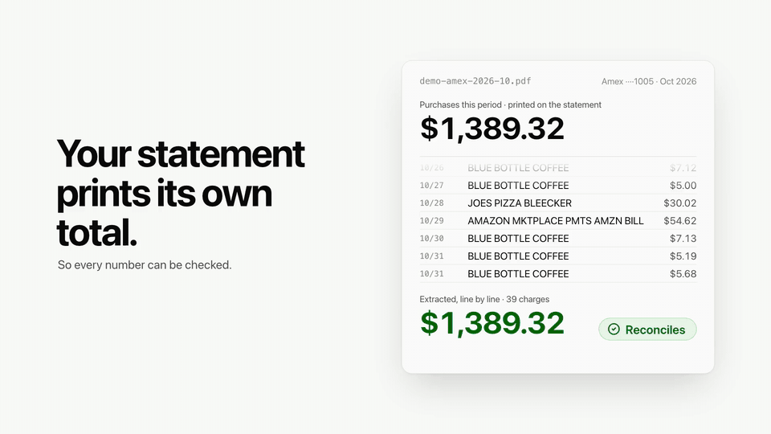

# finances

Personal finance analysis that reads your statement PDFs directly. No bank
login, no Plaid, no account linking, no cloud. Everything runs on your machine
and nothing is uploaded anywhere.

[](docs/demo.mp4)

*20 seconds, on the made-up data from `finances demo`. Click for the full video with sound.*

The thing that makes it different: **a statement prints its own totals, so the
extraction can be proved correct.** Every figure this produces traces back to a
line on a statement, and the tool tells you when it cannot.

```
$ finances check

Store       finances.db
Rows        1180 transactions, 2025-01-03 to 2025-12-29
Statements  36

Reconciled  36/36 (100%)

Every statement reconciles and no months are missing. The totals downstream
are traceable to a statement line.
```

A tool built on a bank API cannot do this. It receives a feed of transactions
with no independent total to check them against, so a dropped charge or a
flipped sign is invisible. Here the statement is the ground truth, and
reconciliation is enforced rather than assumed.

---

# Running it

Three ways in. Pick one; they all end at the same dashboard on
`http://localhost:8787`.

## Try it first, with made-up data

Nobody should have to hand over a year of bank statements to find out whether
a tool is any good. `demo` writes twelve months of an invented checking account
and credit card — paychecks, rent, a subscription that raises its price, a
holiday spike — into a separate `demo.db`. It goes through the same
reconciliation and categorizer as a real statement.

```bash
# with uv
git clone https://github.com/roshanlam/finances && cd finances
uv run finances demo
uv run finances web --db demo.db --open

# or with Docker, nothing else installed
docker compose --profile demo up demo        # then open http://localhost:8787
```

## With your statements: uv

Requires [uv](https://docs.astral.sh/uv/) (it fetches Python 3.12+ if you do
not have it). For the browser dashboard you also need Node 20+; without it
everything in the terminal still works.

```bash
uv sync                                  # one dependency: pdfplumber
mkdir -p PDFs                            # drop your statement PDFs in here
uv run finances pipeline PDFs/           # parse, categorize, check, report
uv run finances web --open               # builds the dashboard on first run
```

Any folder layout works — subfolders are searched too. Tested against Amex,
Chase (card and checking), Capital One and Discover.

**Always look at the `check` verdict at the end before trusting anything
else.** If it does not say 100%, the numbers downstream are built on a bad
extraction, and every other report will tell you so too.

## With your statements: Docker

```bash
mkdir -p PDFs                            # drop your statement PDFs in here
docker compose up                        # then open http://localhost:8787
```

On start the container parses whatever is in `./PDFs` (unchanged files are
skipped), categorizes it, prints the `check` verdict and serves the dashboard.
The store and every generated report land in `./data`. Every command works the
same way inside it:

```bash
docker compose run --rm finances check
docker compose run --rm finances cashflow
docker compose run --rm finances ask --example top-merchants
```

The port is published on `127.0.0.1` only, and `.dockerignore` is a whitelist:
your PDFs and database are never sent to the Docker daemon or baked into an
image.

## The dashboard

Your statements, the reconciliation verdict for each one, spending by month and
category, detected subscriptions, and a searchable transaction table. **You
can drag new statement PDFs straight onto it**: they are parsed on drop, and
the reply tells you how many transactions came out and whether the file
reconciles against its own printed totals.

The server makes no outbound requests, binds to localhost, and refuses any
request that does not come from a page on localhost — so another website open
in the same browser cannot read your transactions from it.

While working on the frontend, run the two halves separately —
`uv run finances web` in one terminal, `cd web && npm run dev` in another, then
use `http://localhost:5173` (it proxies `/api` through).

## Or stay in the terminal

```bash
uv run finances analyze            # where the money went
uv run finances cashflow           # the next 60 days
uv run finances audit              # the reckoning
uv run finances cpi                # your own inflation rate
uv run finances backtest           # how accurate are the forecasts
uv run finances ask "how much did I spend on coffee in March"
```

`uv run finances` on its own lists every command; `uv run finances <command>
--help` shows that tool's own options. Inside an activated virtualenv
(`source .venv/bin/activate`), drop the `uv run`. Without uv at all:
`python3 -m venv .venv && .venv/bin/pip install -e .` and then
`.venv/bin/finances`.

## Configuration

Everything is a flag, and the few things you would otherwise repeat on every
command are also environment variables:

| Variable | Default | What it sets |
|---|---|---|
| `FINANCES_DB` | `finances.db` | the store every command reads and writes |
| `FINANCES_PDF_DIR` | `PDFs/` next to the code | where dashboard uploads are saved |
| `FINANCES_HOST` / `FINANCES_PORT` | `127.0.0.1` / `8787` | where `finances web` listens |
| `FINANCES_LLM_ENDPOINT` | Ollama, LM Studio, llama.cpp on localhost | the model server for `ask` and `enrich` |
| `FINANCES_WEB_DIST` | `web/dist` | a prebuilt dashboard to serve |

---

# Command reference

| Command | What it does | Writes |
|---|---|---|
| `parse PDFs/` | extract transactions from statement PDFs | `finances.db` |
| `check` | reconciliation and coverage report | — |
| `categorize apply` | label transactions, write back to the store | `finances.db` |
| `analyze` | spending dashboard | `finance_dashboard.html`, `insights.md` |
| `cashflow` | daily balance projection with a low-point warning | `cashflow.html` |
| `plan status` | savings goals against your real surplus | `plan.json` |
| `audit` | a strict grandfather goes through your statements | `auditor_ledger.json` |
| `cpi` | personal inflation, per merchant and per category | `cpi.html` |
| `backtest` | grades the forecasts against what actually happened | `backtest.html` |
| `ask "..."` | plain-English questions, answered offline | — |
| `anonymize` | a copy safe to share | `transactions_shareable.csv` |
| `enrich` | local-LLM merchant cleanup | `finances.db` |
| `web` | serve the browser dashboard, with PDF drag-and-drop | — |
| `demo` | a year of made-up statements, to try everything on | `demo.db` |
| `pipeline PDFs/` | parse + categorize + analyze in one run | all of the above |

Every command accepts either the SQLite store or a CSV, interchangeably:

```bash
uv run finances analyze --db finances.db
uv run finances analyze cleanedData/transactions.csv
```

## Things you will probably need

```bash
# Encrypted PDFs
uv run finances parse PDFs/ --password 1234

# A statement extracted wrong — see what the parser saw
uv run finances parse "PDFs/one bad file.pdf" --dump-columns

# Fail the build if anything does not reconcile (for a cron job)
uv run finances check --strict

# Re-parse everything, ignoring the cache
uv run finances parse PDFs/ --force

# Tell it your take-home pay, so it can work out what is left over
uv run finances analyze --income 6200

# Teach the categorizer, biggest money first
uv run finances categorize review
```

## Asking questions offline

`ask` needs a local model server. Without one, `--sql` and `--examples` still
work:

```bash
uv run finances ask --examples
uv run finances ask --sql "SELECT category, SUM(amount) FROM transactions GROUP BY 1 ORDER BY 2 DESC"
```

With one:

```bash
brew install ollama && ollama pull llama3.1:8b
uv run finances ask "what did I spend on delivery last month" --explain
```

Something in the 3B–8B range is plenty. Avoid reasoning models here — they take
minutes per question for no benefit on this task. Pick explicitly with
`--model llama3.1:8b`.

## If something goes wrong

| Symptom | Cause and fix |
|---|---|
| `finances.db does not exist` | Run `parse` first. |
| `check` reports mismatches | The extraction is wrong for those files. Run `finances parse <file> --dump-columns` to see the columns it found. |
| `check` reports gaps | A statement month is missing from your folder. Totals are being computed on incomplete data. |
| Lots of `Uncategorized` | `categorize review` to teach it, or `enrich` to use a local LLM. |
| `cashflow` will not project | It could not find a checking-account balance. Pass `--balance 2400`. |
| Amounts look wrong | Almost always a column-detection problem. `--dump-columns`, then `--amount-col last` or `second-last` to override. |

---

# How it fits together

```
PDFs ──▶ parse.py ──▶ finances.db ──▶ engine.py ──▶ every other tool
              │                          │
       reconciles each              the read model: what counts as
       statement against            spending, which months are complete,
       its printed totals           what repeats, what is verified
```

```
finances/          the package — one module per tool, plus the shared core below
  cli.py           `finances <command>`: the front door, dispatches to each tool
  parse.py         PDFs -> the store, reconciling each statement as it goes
  engine.py        the read model every tool shares
  api.py           the dashboard's JSON API and static server
  demo.py          the made-up store
  ...              analyze, cashflow, cpi, backtest, ask, planner, anonymize, ...
web/               the dashboard (React + Vite), served by `finances web`
tests/             stdlib unittest, no test dependencies
docker/  Dockerfile  docker-compose.yml
```

Every module still runs on its own too: `python -m finances.parse --help`.

- **`models.py`** — one definition of a transaction and a statement. The SQLite
  schema and the CSV columns are both generated from it, so adding a field is a
  single edit and the store migrates itself.
- **`database.py`** — the store, plus a content-hash cache so re-running the
  parser skips files that have not changed.
- **`utils.py`** — money, date and merchant parsing, the debt formulas, and the
  recurring-charge detector.
- **`engine.py`** — the semantics. Everything downstream agrees about what a
  month, a surplus and a subscription are because they all ask this.

# What it does that other tools do not

**Proves its own numbers.** Extracted charges are checked against the total the
statement prints for itself, and the verdict is stored, not just displayed.
Missing statement months are detected and reported as gaps, so an average is
never quietly computed over incomplete data.

This is not decorative. Building it found a noise filter matching the month
"Apr" and discarding entire statements, sign inversions on two issuers, a
year-rollover that dated 62 transactions to the wrong December, and a primary
key that silently dropped 41 of one statement's 181 transactions. All of them
looked fine in a dashboard. None survive a reconciliation check.

**Tells you about next month, not just last month.** `cashflow` projects the
daily balance forward from known recurring charges and detected paycheck
cadence — distinguishing semi-monthly from biweekly, because biweekly gives you
three-paycheck months and that changes the answer. It reports a band rather than
a line and says plainly that it is not a confidence interval.

**Measures your inflation, not the country's.** `cpi` weights per-category price
changes by your spending and tracks per-merchant prices over time, against real
BLS Consumer Expenditure and CPI-U reference data shipped with the project.

**Grades its own forecasts.** `backtest` walks forward month by month, predicts
each month using only data from before it, and scores nine predictors against
what happened. It refuses to name a winner when the sample cannot support one.

**Makes your data shareable.** `anonymize` has four levels up to fully
synthetic, and proves what survived — per-category totals are printed side by
side so you can see which figures are still exactly true.

# Categorization

Rules, in order, first hit wins. Every answer records which rule fired and how
confident it is:

1. what you taught it (`learned_rules.json`, always wins)
2. context rules — `COSTCO`+`GAS` is fuel, `UBER`+`EATS` is delivery
3. bank phrases — a deposit account names its own transaction type
4. brand table, exact token match, never substring
5. keyword rules, word-boundary regex
6. issuer MCC labels, where the statement prints its own category
7. behaviour — cadence and amount, when the name says nothing

Scored against 159 real-shaped descriptors with processor prefixes, glued
city/state suffixes and issuer preambles:

```
$ uv run finances categorize eval
  correct         159  100.0%
  wrong             0    0.0%   <- these corrupt analysis
  left unknown      0    0.0%   <- these are honest
```

# Tests

```bash
uv run python -m unittest discover tests
```

250 tests, no test dependencies. The parser's golden-file tests skip when
`PDFs/` is empty, so a fresh clone runs the rest. The golden-file harness
records per-statement extraction totals so a parser change that moves a number
is visible:

```bash
uv run python tests/run.py --update-golden   # after a deliberate change
uv run python tests/run.py --check-golden    # exits 1 on drift
```

# Privacy

Your statements and the store never leave the machine. `PDFs/`, `*.db`, the
generated dashboards and `anonymize_map.json` are all gitignored. The map file
is what turns `MERCHANT_007` back into a real name — keep it, do not share it.

`ask` and `enrich` talk only to a model server on localhost. Nothing else in
the project makes a network request at all.

# Not financial advice

Arithmetic on your own statements. The forecasts are extrapolations of your past
spending and say so, `backtest` will tell you how wrong they have been, and none
of it knows anything about your life beyond what the statements print.
